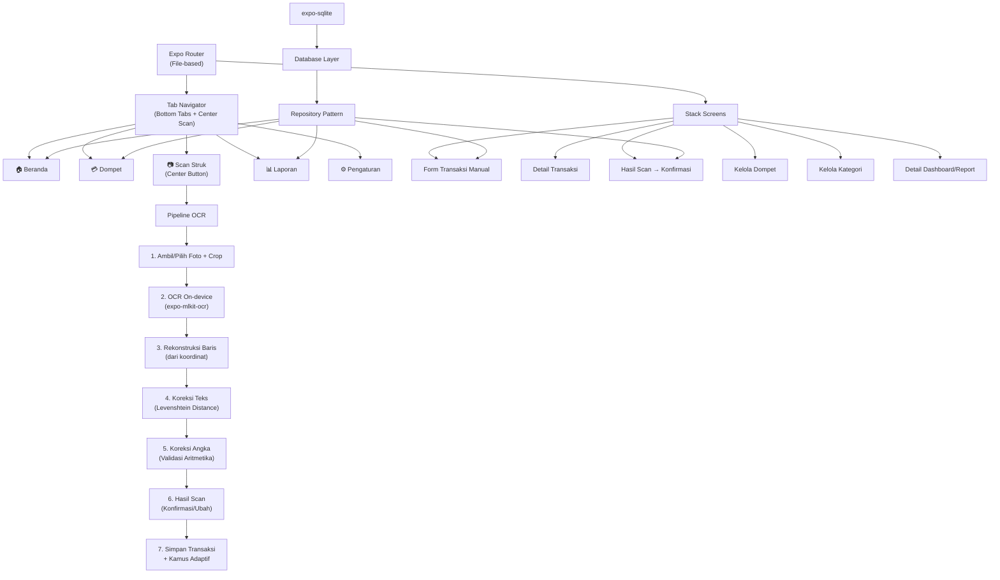
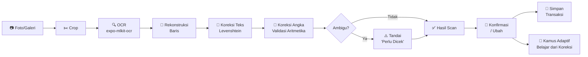
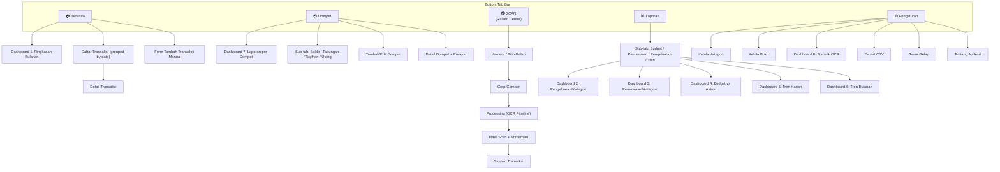
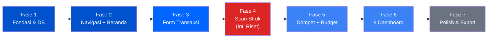

# 📱 Perencanaan Pembangunan Aplikasi Kaskuy

> Aplikasi pencatatan keuangan pribadi dengan fitur utama **scan struk on-device** (OCR + koreksi Levenshtein Distance + validasi aritmetika).

---

## 1. Ringkasan Proyek

| Aspek               | Detail                                                                                                             |
| ------------------- | ------------------------------------------------------------------------------------------------------------------ |
| **Nama**            | Kaskuy                                                                                                             |
| **Platform**        | Android (Expo / React Native, build lokal)                                                                         |
| **Backend**         | Tidak ada — semua data & proses berjalan di HP (offline)                                                           |
| **Database**        | `expo-sqlite` (lokal)                                                                                              |
| **Fokus Riset**     | Akurasi ekstraksi data dari struk fisik via OCR on-device                                                          |
| **Struk Digital**   | Screenshot nota online — fitur tambahan, bukan fokus utama                                                         |
| **Unsur Indonesia** | Pola batik geometris (kawung/ceplok) — hanya di kartu saldo & empty state, tipis agar tidak mengganggu keterbacaan |

---

## 2. Arsitektur Aplikasi



---

## 3. Alur Scan Struk (Inti Riset)

Ini adalah fitur inti dan fokus riset utama. Pipeline pemrosesan struk:



### Detail Setiap Tahap

#### Tahap 1 — Akuisisi Gambar

- Ambil foto langsung via kamera atau pilih dari galeri (`expo-image-picker`)
- Fitur crop untuk memfokuskan area struk (`expo-image-manipulator`)
- Simpan gambar original sebagai bukti

#### Tahap 2 — OCR On-device

- Gunakan `expo-mlkit-ocr` untuk mengenali teks
- Simpan teks mentah **beserta koordinat** setiap block/line/element
- Catat waktu proses OCR untuk evaluasi performa

#### Tahap 3 — Rekonstruksi Baris

- OCR sering mengembalikan blok teks tanpa urutan yang benar
- Urutkan elemen berdasarkan koordinat Y (baris) lalu X (kolom)
- Gabungkan elemen yang berada pada baris Y yang sama (tolerance threshold)
- Hasilkan array baris terstruktur dari atas ke bawah

#### Tahap 4 — Koreksi Teks (Levenshtein Distance)

- **Kamus toko**: Indomaret, Alfamart, Alfamidi, dll → normalisasi nama merchant
- **Kamus label**: TOTAL, TUNAI, KEMBALI, SUBTOTAL, DPP, PPN → identifikasi baris penting
- **Kamus produk** (opsional): belajar dari data sebelumnya
- **Confusable characters**: O→0, I→1, S→5, B→8, Z→2, l→1 (karakter yang sering tertukar OCR)
- Threshold: Levenshtein distance ≤ 1 untuk kata pendek (≤8 huruf), ≤ 2 untuk kata panjang

#### Tahap 5 — Koreksi Angka + Validasi Aritmetika

- Ekstrak semua kandidat angka uang dari setiap baris
- Cari angka yang diasosiasikan dengan label (TOTAL, TUNAI, KEMBALI)
- **Validasi 1**: jumlah_item × harga_satuan = harga_baris (jika terbaca)
- **Validasi 2**: total_semua_baris = TOTAL
- **Validasi 3**: TUNAI - KEMBALI = TOTAL
- Jika tidak konsisten → tandai ambigu, cari triple konsisten sebagai fallback

#### Tahap 6 — Scoring & Confidence

- **High**: keyword TOTAL terbaca + aritmetika valid + merchant teridentifikasi
- **Medium**: keyword tidak terbaca tapi triple konsisten ditemukan
- **Low**: hanya estimasi dari angka terbesar / angka pertama
- Jika confidence ≠ high → tandai `needsConfirmation: true`

#### Tahap 7 — Konfirmasi & Kamus Adaptif

- Tampilkan layar "Hasil Scan" dengan data ter-parse
- Highlight bagian yang "perlu dicek" (warna kuning/oranye)
- User bisa mengubah merchant, total, kategori, catatan
- **Kamus Adaptif**: simpan koreksi user → pelajari pola untuk scan berikutnya
  - Jika user mengoreksi merchant "INDOMRET" → "Indomaret", tambahkan ke kamus
  - Jika user mengoreksi angka, catat pattern kesalahan OCR

---

## 4. Desain Database (SQLite)

```mermaid
erDiagram
    wallets ||--o{ transactions : has
    categories ||--o{ transactions : categorizes
    categories ||--o{ budgets : limits
    books ||--o{ transactions : contains
    books ||--o{ wallets : groups
    books ||--o{ budgets : scopes
    transactions ||--o| scan_results : "scanned from"
    scan_results ||--o{ ocr_corrections : "learned from"

    books {
        integer id PK
        text name
        integer is_default
        text created_at
    }

    wallets {
        integer id PK
        integer book_id FK
        text name
        text type "cash | bank | ewallet | credit_card"
        real balance
        text icon
        text color
        integer is_archived
        text created_at
    }

    categories {
        integer id PK
        text name
        text type "income | expense"
        text icon
        text color
        integer sort_order
        integer is_default
    }

    transactions {
        integer id PK
        integer book_id FK
        integer wallet_id FK
        integer category_id FK
        text type "income | expense"
        real amount
        text note
        text date
        integer scan_result_id FK "nullable"
        text created_at
        text updated_at
    }

    budgets {
        integer id PK
        integer book_id FK
        integer category_id FK
        real amount
        text month "YYYY-MM"
        text created_at
    }

    scan_results {
        integer id PK
        text image_uri
        text raw_ocr_text
        text reconstructed_lines "JSON array"
        text parsed_data "JSON: merchant, total, tunai, kembali, items"
        text confidence "high | medium | low"
        integer needs_confirmation
        integer was_corrected "0 | 1"
        text corrected_data "JSON - data setelah koreksi user"
        integer ocr_duration_ms
        text created_at
    }

    ocr_corrections {
        integer id PK
        integer scan_result_id FK
        text field "merchant | total | tunai | kembali | item"
        text original_value
        text corrected_value
        text created_at
    }

    merchant_dictionary {
        integer id PK
        text raw_text "teks asli OCR"
        text normalized_name "nama merchant yang benar"
        integer frequency "berapa kali muncul"
        text created_at
        text updated_at
    }
```



---

## 5. Struktur Folder

```
src/
├── app/                          # Expo Router routes
│   ├── _layout.tsx               # Root layout (providers, DB init)
│   ├── (tabs)/                   # Tab navigator group
│   │   ├── _layout.tsx           # Tab bar config (4 tab + center scan)
│   │   ├── index.tsx             # 🏠 Beranda
│   │   ├── wallet.tsx            # 💳 Dompet
│   │   ├── report.tsx            # 📊 Laporan (8 dashboard)
│   │   └── settings.tsx          # ⚙️ Pengaturan
│   ├── scan/
│   │   ├── camera.tsx            # Ambil foto / pilih galeri
│   │   ├── crop.tsx              # Crop area struk
│   │   ├── processing.tsx        # Loading OCR + pipeline
│   │   └── result.tsx            # Hasil scan → konfirmasi/ubah
│   ├── transaction/
│   │   ├── add.tsx               # Form tambah transaksi manual
│   │   └── [id].tsx              # Detail / edit transaksi
│   ├── wallet/
│   │   ├── add.tsx               # Tambah dompet
│   │   └── [id].tsx              # Detail dompet + riwayat
│   ├── budget/
│   │   └── add.tsx               # Tambah / edit budget
│   └── report/
│       └── [type].tsx            # Detail dashboard/report spesifik
│
├── components/                   # Reusable UI components
│   ├── ui/                       # Primitif: Button, Card, BottomSheet, etc.
│   ├── transaction/              # TransactionCard, TransactionList
│   ├── wallet/                   # WalletCard, WalletSelector
│   ├── report/                   # ChartCard, BudgetBar, StatCard
│   ├── scan/                     # ScanOverlay, ConfidenceBadge, CorrectionField
│   ├── decorative/               # BatikPattern (kawung/ceplok SVG patterns)
│   └── common/                   # Header, EmptyState, AmountDisplay
│
├── db/                           # Database layer
│   ├── schema.ts                 # SQL CREATE TABLE statements
│   ├── database.ts               # expo-sqlite init & migrations
│   ├── repositories/
│   │   ├── transactionRepo.ts
│   │   ├── walletRepo.ts
│   │   ├── categoryRepo.ts
│   │   ├── budgetRepo.ts
│   │   ├── bookRepo.ts
│   │   ├── scanResultRepo.ts
│   │   ├── ocrCorrectionRepo.ts
│   │   └── merchantDictRepo.ts
│   └── seeds.ts                  # Default categories, book, merchant dictionary
│
├── hooks/                        # Custom React hooks
│   ├── useTransactions.ts
│   ├── useWallets.ts
│   ├── useBudgets.ts
│   ├── useCategories.ts
│   ├── useSummary.ts             # Aggregated income/expense per period
│   ├── useDashboard.ts           # Hook untuk 8 luaran dashboard
│   └── useScanPipeline.ts        # Orchestrate entire scan flow
│
├── lib/                          # Pure logic (no React)
│   ├── ocr/
│   │   ├── reconstructLines.ts   # Tahap 3: koordinat → baris terurut
│   │   ├── correctText.ts        # Tahap 4: Levenshtein correction
│   │   ├── correctNumbers.ts     # Tahap 5: validasi aritmetika
│   │   ├── scoring.ts            # Tahap 6: confidence scoring
│   │   └── adaptiveDictionary.ts # Tahap 7: kamus adaptif
│   ├── parseReceipt.ts           # (existing) - akan di-refactor ke ocr/
│   ├── levenshtein.ts            # Levenshtein distance algorithm
│   ├── currency.ts               # Format Rp, parsing angka
│   └── date.ts                   # Date helpers (period grouping)
│
├── constants/
│   ├── theme.ts                  # Colors, Fonts, Spacing, Shadows
│   ├── categories.ts             # Default category list + icons
│   ├── merchants.ts              # Built-in merchant dictionary
│   └── ocrConfig.ts              # OCR thresholds, confusable chars map
│
└── types/
    └── index.ts                  # Shared TypeScript types
```

---

## 6. Konsep Desain: Modern Mobile Banking + Sentuhan Indonesia

### Prinsip Desain

| Aspek               | Detail                                                                                       |
| ------------------- | -------------------------------------------------------------------------------------------- |
| **Style**           | Modern mobile banking (BCA mobile, Jago, Blu) — bersih, elegan, informatif                   |
| **Color Scheme**    | Primary Deep Blue + gradient. Dark mode native.                                              |
| **Unsur Indonesia** | Pola batik kawung/ceplok geometris — HANYA di kartu saldo hero & empty state, opacity rendah |
| **Typography**      | System font, weight hierarchy jelas (Bold → Medium → Regular)                                |
| **Cards**           | Rounded-2xl (16-20px), subtle shadows, glassmorphism untuk hero card                         |
| **Navbar**          | 4 tab + raised center button (scan) — lingkaran biru dengan ikon scan viewfinder             |
| **Icons**           | SVG line icons minimalis, outline (inactive) → filled (active)                               |
| **Animations**      | Smooth via `react-native-reanimated`, budget bars animated                                   |
| **Angka**           | Font besar untuk saldo, format Rp konsisten, hijau (income) / merah (expense)                |
| **Empty States**    | Ilustrasi ringan + pola batik tipis + teks ajakan friendly                                   |

### Palet Warna

```
Light Mode:
  Background:     #F5F7FA (soft gray)
  Surface:        #FFFFFF
  Primary:        #0066FF (deep blue)
  Primary Dark:   #0052CC
  Success:        #00C48C (green — income)
  Danger:         #FF4757 (red — expense)
  Warning:        #F59E0B (amber — perlu dicek)
  Text Primary:   #1A1A2E
  Text Secondary: #6B7280
  Text Muted:     #9CA3AF

Dark Mode:
  Background:     #0A0A0F
  Surface:        #1A1A2E
  Primary:        #3B82F6
  Success:        #34D399
  Danger:         #F87171
  Warning:        #FBBF24
  Text Primary:   #F9FAFB
  Text Secondary: #9CA3AF
```

### Unsur Batik

- **Pola**: Kawung (bentuk oval berulang) atau Ceplok (bentuk geometris simetris)
- **Penerapan**: Hanya sebagai background pattern di:
  - Hero card saldo (opacity 5-8%, warna putih di atas gradient biru)
  - Empty state ilustrasi (opacity 8-12%, warna abu-abu)
- **Tidak boleh** mengganggu keterbacaan teks atau angka

---

## 7. Delapan Luaran Dashboard / Report

Minimal **8 dashboard/report** yang wajib ada:

### Dashboard 1 — Ringkasan Keuangan Bulanan

- **Deskripsi**: Overview utama di halaman Beranda
- **Data**: Total saldo, pemasukan, pengeluaran bulan berjalan
- **Visual**: Hero card dengan gradient + angka besar
- **Interaksi**: Navigasi bulan (← Nov 2026 →), toggle periode (Harian/Mingguan/Bulanan/Tahunan)

### Dashboard 2 — Pengeluaran per Kategori

- **Deskripsi**: Breakdown pengeluaran berdasarkan kategori
- **Data**: Total per kategori (Makanan, Belanja, Transport, dll)
- **Visual**: Horizontal bar chart / proportional bars per kategori
- **Interaksi**: Klik kategori → daftar transaksi dalam kategori itu

### Dashboard 3 — Pemasukan per Kategori

- **Deskripsi**: Breakdown pemasukan berdasarkan sumber
- **Data**: Total per kategori income (Gaji, Bisnis, Freelance, dll)
- **Visual**: Horizontal bar chart per kategori
- **Interaksi**: Klik kategori → daftar transaksi pemasukan

### Dashboard 4 — Budget vs Aktual

- **Deskripsi**: Tracking budget per kategori pengeluaran
- **Data**: Budget yang ditetapkan vs jumlah terpakai per kategori per bulan
- **Visual**: Progress bar per kategori, warna berubah saat mendekati/melebihi budget
- **Interaksi**: Tambah/edit budget, alert jika >90% terpakai

### Dashboard 5 — Tren Harian (7 Hari Terakhir)

- **Deskripsi**: Grafik pengeluaran harian selama 7 hari terakhir
- **Data**: Total pengeluaran per hari
- **Visual**: Bar chart 7 kolom (Sen-Min), highlight hari ini
- **Interaksi**: Tap bar → detail transaksi hari itu

### Dashboard 6 — Tren Bulanan (6 Bulan Terakhir)

- **Deskripsi**: Perbandingan pengeluaran & pemasukan antar bulan
- **Data**: Total income & expense per bulan selama 6 bulan terakhir
- **Visual**: Grouped bar chart (hijau = income, merah = expense)
- **Interaksi**: Tap bulan → ringkasan bulan itu

### Dashboard 7 — Laporan per Dompet

- **Deskripsi**: Riwayat dan statistik per dompet/akun
- **Data**: Saldo, jumlah transaksi, income/expense per dompet
- **Visual**: Card per dompet dengan mini summary
- **Interaksi**: Klik → riwayat transaksi dompet itu

### Dashboard 8 — Statistik & Akurasi OCR

- **Deskripsi**: Laporan performa fitur scan struk (penting untuk riset)
- **Data**:
  - Total struk di-scan
  - Distribusi confidence (high / medium / low)
  - Persentase yang perlu koreksi manual
  - Rata-rata waktu proses OCR (ms)
  - Merchant paling sering di-scan
  - Tingkat akurasi per field (merchant, total, tunai, kembali)
- **Visual**: Stat cards + mini charts
- **Interaksi**: Tap → detail scan history

---

## 8. Navigasi & Layar



---

## 9. Fase Pengembangan

### Fase 1 — Fondasi & Database

> **Goal:** Setup database, seed data, arsitektur, dan design system.

- [ ] Refactor folder structure sesuai rencana
- [ ] Setup `expo-sqlite` database dengan schema lengkap (termasuk tabel scan_results, ocr_corrections, merchant_dictionary)
- [ ] Buat migration system sederhana (version-based)
- [ ] Buat seed data: default categories, default book, built-in merchant dictionary
- [ ] Buat repository layer (CRUD untuk semua 8 entity)
- [ ] Buat TypeScript types untuk semua entity
- [ ] Setup theme system baru (palet warna, dark mode, spacing tokens)
- [ ] Buat komponen BatikPattern (SVG kawung/ceplok) untuk dekorasi
- [ ] Buat komponen UI dasar: Button, Card, AmountDisplay, EmptyState
- [ ] Lint & typecheck pass

### Fase 2 — Bottom Tab Navigation + Beranda

> **Goal:** Navigasi utama dengan center scan button + halaman beranda (Dashboard 1).

- [ ] Setup Expo Router tab layout: 4 tab + center scan button (raised)
- [ ] Custom Bottom Tab Bar component (sesuai desain preview)
- [ ] **Dashboard 1**: Hero card saldo (gradient + batik pattern)
- [ ] Period tabs (Harian / Mingguan / Bulanan / Tahunan)
- [ ] Transaction list grouped by date
- [ ] Transaction card component (icon, nama, kategori, waktu, jumlah)
- [ ] Empty state dengan pola batik
- [ ] Lint & typecheck pass

### Fase 3 — Form Transaksi Manual

> **Goal:** Input pemasukan & pengeluaran tanpa scan.

- [ ] Tab toggle: Pengeluaran ↔ Pemasukan
- [ ] Amount input dengan custom numeric keypad
- [ ] Wallet selector dropdown
- [ ] Category grid picker (SVG icon + label)
- [ ] Date picker
- [ ] Note field
- [ ] Simpan ke database + otomatis update wallet balance
- [ ] Edit & hapus transaksi
- [ ] Lint & typecheck pass

### Fase 4 — Pipeline Scan Struk (Inti Riset)

> **Goal:** Implementasi penuh alur OCR dari foto hingga tersimpan.

- [ ] Screen: Kamera / Pilih Galeri (`expo-image-picker`)
- [ ] Screen: Crop area struk (`expo-image-manipulator`)
- [ ] Screen: Processing — tampilkan loading + progress
- [ ] Refactor `parseReceipt.ts` → modul-modul terpisah di `src/lib/ocr/`
- [ ] `reconstructLines.ts` — susun baris dari koordinat OCR
- [ ] `correctText.ts` — Levenshtein distance correction (merchant, label, produk)
- [ ] `correctNumbers.ts` — validasi aritmetika (item×harga=baris, Σbaris=total, tunai-kembali=total)
- [ ] `scoring.ts` — confidence scoring (high/medium/low)
- [ ] `adaptiveDictionary.ts` — simpan koreksi user, belajar dari pola
- [ ] Screen: Hasil Scan — tampilkan data ter-parse, highlight bagian ambigu
- [ ] Konfirmasi/edit oleh user → simpan transaksi + update kamus adaptif
- [ ] Simpan scan_result + koreksi ke database
- [ ] Lint & typecheck pass

### Fase 5 — Dompet + Budget

> **Goal:** Kelola akun keuangan + budget tracking.

- [ ] Tab Dompet — sub-tabs: Saldo / Tabungan / Tagihan / Utang
- [ ] Wallet cards (icon, nama, tipe, saldo)
- [ ] Total saldo card dengan batik pattern
- [ ] Form tambah/edit dompet (nama, tipe, saldo awal, ikon, warna)
- [ ] **Dashboard 7**: Detail dompet + riwayat transaksi per dompet
- [ ] **Dashboard 4**: Budget vs Aktual — progress bar per kategori
- [ ] Form tambah/edit budget per kategori per bulan
- [ ] Lint & typecheck pass

### Fase 6 — Laporan & Dashboard (8 Luaran)

> **Goal:** Semua 8 dashboard/report berfungsi lengkap.

- [ ] Tab Laporan — sub-tabs: Budget / Pemasukan / Pengeluaran / Tren
- [ ] **Dashboard 2**: Pengeluaran per Kategori (bar chart)
- [ ] **Dashboard 3**: Pemasukan per Kategori (bar chart)
- [ ] **Dashboard 5**: Tren Harian — bar chart 7 hari terakhir
- [ ] **Dashboard 6**: Tren Bulanan — grouped bar chart 6 bulan terakhir
- [ ] **Dashboard 8**: Statistik & Akurasi OCR
  - Total scan, distribusi confidence, % koreksi manual
  - Rata-rata waktu OCR, merchant tersering, akurasi per field
- [ ] Navigasi bulan (← Nov 2026 →) di semua dashboard yang relevan
- [ ] Tap chart element → drill down ke daftar transaksi
- [ ] Lint & typecheck pass

### Fase 7 — Pengaturan & Polish

> **Goal:** Pengaturan, export, dan sentuhan akhir.

- [ ] Halaman Pengaturan lengkap
- [ ] Toggle tema gelap / terang
- [ ] Kelola kategori: tambah / edit / hapus custom categories
- [ ] Kelola buku (multi-book support)
- [ ] Export data ke CSV
- [ ] Onboarding screen (first launch) — penjelasan fitur scan
- [ ] Haptic feedback (`expo-haptics`)
- [ ] Micro-animations & transitions (shared element, list animations)
- [ ] Review aksesibilitas (contrast, font size, touch targets)
- [ ] Final lint & typecheck pass
- [ ] Test di device Android fisik

---

## 10. Dependencies

| Package                          | Kegunaan                 | Status                                      |
| -------------------------------- | ------------------------ | ------------------------------------------- |
| `expo` (SDK 57)                  | Framework                | ✅ Installed                                |
| `expo-router`                    | Navigation & routing     | ✅ Installed                                |
| `expo-sqlite`                    | Database lokal           | ✅ Installed                                |
| `expo-mlkit-ocr`                 | OCR on-device            | ✅ Installed                                |
| `expo-image-picker`              | Pilih/ambil foto         | ✅ Installed                                |
| `expo-image-manipulator`         | Crop gambar struk        | ✅ Installed                                |
| `react-native-reanimated`        | Animasi smooth           | ✅ Installed                                |
| `react-native-gesture-handler`   | Gesture (swipe, drag)    | ✅ Installed                                |
| `react-native-safe-area-context` | Safe area insets         | ✅ Installed                                |
| `expo-haptics`                   | Haptic feedback          | 🔲 Perlu install                            |
| `@expo/vector-icons`             | Ikon UI                  | 🔲 Cek apakah perlu (bisa pakai custom SVG) |
| `expo-linear-gradient`           | Gradient pada hero cards | 🔲 Perlu install                            |

> **Catatan:** Semua package diinstall via `npx expo install <package>` agar versi kompatibel SDK 57. Tidak ada backend / package networking yang diperlukan.

---

## 11. Keputusan Teknis

| Keputusan            | Pilihan                    | Alasan                                         |
| -------------------- | -------------------------- | ---------------------------------------------- |
| **State Management** | React Context + hooks      | Cukup untuk skala ini, offline-only            |
| **Database**         | expo-sqlite (sync API)     | Sudah ada, performant, fully offline           |
| **Styling**          | StyleSheet + theme tokens  | Konsisten, no extra deps                       |
| **Navigation**       | Expo Router (file-based)   | Sesuai AGENTS.md, typed routes                 |
| **Charts**           | Custom SVG components      | Avoid heavy charting lib, kontrol penuh        |
| **Icons**            | Custom SVG line icons      | Minimalis, konsisten, no extra package         |
| **OCR**              | expo-mlkit-ocr (ML Kit)    | On-device, offline, cukup akurat untuk struk   |
| **Koreksi Teks**     | Levenshtein Distance       | Robust untuk OCR errors, tunable threshold     |
| **Kamus**            | SQLite merchant_dictionary | Persistant, adaptif, bisa di-export            |
| **Batik Pattern**    | SVG path di React Native   | Lightweight, scalable, mudah dikontrol opacity |

---

## 12. Urutan Pengerjaan



> **Fase 4 (merah)** adalah inti riset — harus mendapat alokasi waktu dan pengujian paling banyak.

---

## 13. Metrik Evaluasi Riset (Scan Struk)

Untuk kebutuhan riset/skripsi, data berikut dikumpulkan otomatis oleh Dashboard 8:

| Metrik                         | Cara Ukur                                             |
| ------------------------------ | ----------------------------------------------------- |
| **Akurasi Merchant**           | % scan yang merchant-nya benar tanpa koreksi          |
| **Akurasi Total**              | % scan yang total-nya benar tanpa koreksi             |
| **Akurasi Tunai/Kembali**      | % scan yang tunai & kembali benar                     |
| **Distribusi Confidence**      | Proporsi high / medium / low dari semua scan          |
| **Correction Rate**            | % scan yang memerlukan koreksi manual                 |
| **Avg OCR Duration**           | Rata-rata waktu proses OCR (ms)                       |
| **Dictionary Growth**          | Jumlah entri kamus adaptif yang ditambah dari koreksi |
| **Arithmetic Validation Rate** | % scan yang lolos validasi tunai - kembali = total    |

Semua metrik ini tersimpan di SQLite dan bisa di-export CSV untuk analisis lebih lanjut.
